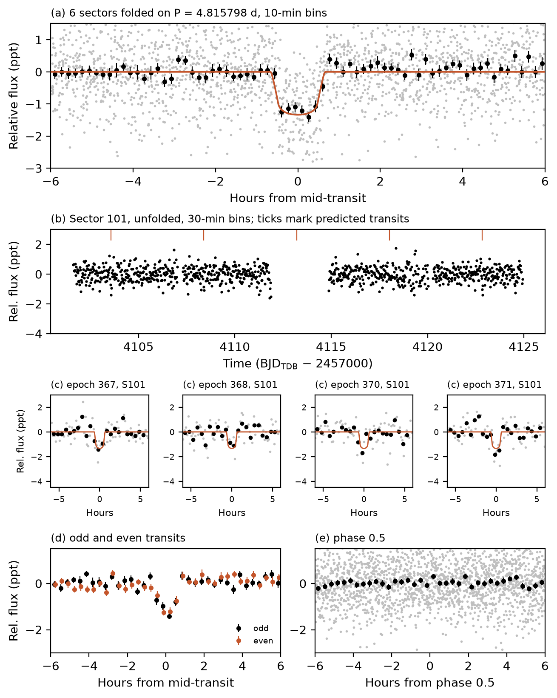

# A 1.2 Earth-radius Planet Candidate on a 4.8-day Orbit around the Nearby M Dwarf TIC 264151965

Advait Paliwal
Independent researcher, Sterling Heights, MI 48314, USA
advaitpaliwal@gmail.com

## Abstract

I report a transit-like signal on TIC 264151965, an M dwarf at 21.2 pc, found in a search of 3,883 nearby red dwarfs. TESS photometry from six sectors spanning 2021–2026 shows 29 transits with a period of 4.815798 d, a depth of 1,255 ± 66 ppm and a duration of 1.16 h. A transit fit gives a radius of 1.16 (+0.05/−0.04) R⊕, and the insolation is 8.8 S⊕. Odd and even depths agree, there is no secondary eclipse, the dip is in the raw flux, and difference images place it on the target and rule out every Gaia star within 150″ brighter than G = 20.5. With no neighbours removed, TRICERATOPS gives FPP = 0.079 ± 0.004; with Gaia companion limits from MOLUSC, FPP = 0.020 ± 0.009. Both exceed the 0.015 validation threshold, so I make no validation claim. The star is not a TOI.

## Star and search

TIC 264151965 (Stassun et al. 2019; Paegert et al. 2021) has T = 10.95, Teff = 3430 K, R★ = 0.310 R☉ and M★ = 0.289 M☉. Gaia DR3 gives G = 12.13, parallax 47.09 mas and RUWE 1.18 (Gaia Collaboration et al. 2023).

I searched TESS (Ricker et al. 2015) light curves of three pools of TIC v8.2 dwarfs: Teff = 2800–4000 K within 100 pc and either inside 12.5° of the north ecliptic pole (1,211 stars) or below ecliptic latitude −78° with logg > 4.0 (1,216), each with at least eight sectors; and Teff = 2700–4000 K within 25 pc outside the continuous viewing zones with at least three sectors (1,456, including this star). I dropped known TOI, CTOI and planet hosts, SPOC threshold-crossing-event (TCE) hosts and Eumemic (2026) candidates. Per sector I used SPOC 2-minute PDCSAP (Jenkins et al. 2016), else full-frame-image photometry from TESS-SPOC or QLP (Huang et al. 2020a, 2020b; Kunimoto et al. 2021); here, SPOC in Sectors 38 and 65, QLP in 99–102. Each was flattened with a 0.75 d wotan biweight filter (Hippke et al. 2019) and binned to 30 minutes. I searched 0.5–60 d (1–60 d beyond 25 pc) in up to four passes, 1,133 stars with Transit Least Squares (Hippke & Heller 2019) and 2,750 with the cuvarbase GPU box search (Hoffman 2022). The cuvarbase threshold, 21.7, is the highest score on flux-inverted light curves of 20 pool stars; the search recovered TOI-700 b, c and d, TOI-2094 b and TOI-2095 b and c.

Peaks above threshold with at least three transits went to the flux-level tests of LEO-vetter v1.2.0 (Kunimoto et al. 2025), which passed four known planets and failed 23 known artifacts. Three signals passed: an eclipsing binary, the candidate TIC 38699429, and this star (score 27.6).

## Transit fit

I fitted the 2,501 10-minute points within 0.3 d of transit with batman (Kreidberg 2015) and emcee (Foreman-Mackey et al. 2013), with a circular orbit, fixed period, quadratic limb darkening fixed at u₁ = 0.25, u₂ = 0.35, and uniform priors (no stellar-density prior). χ² sums squared residuals divided by the per-point scatter, 875 ppm (1.4826 × the out-of-transit median absolute deviation). It gives Rp/R★ = 0.0342 (+0.0015/−0.0011), b = 0.35 (+0.31/−0.24), duration 1.16 (+0.05/−0.04) h and Rp = 1.16 (+0.05/−0.04) R⊕. The fitted density, 24 (+6/−11) g cm⁻³, agrees at about 1σ with 13.7 g cm⁻³ from the TIC mass and radius; fixing a/R★ to it raises the best χ² by 0.20 and gives b = 0.63 and Rp = 1.18 R⊕. Transit Least Squares gives P = 4.81581 ± 0.00010 d and T0 = 2459336.1772 BJD_TDB. At 0.0369 AU the insolation is 8.8 S⊕.

## Vetting

A box fit (in-transit mean against the median 0.04–0.29 d from mid-transit) gives 1,255 ± 66 ppm (19.0σ). Odd and even depths are 1,258 ± 93 and 1,266 ± 93 ppm (0.06σ). Phase 0.5 gives −98 ± 76 ppm, and the strongest dip at any other phase is 3.7σ. Sector depths give χ² = Σ((dᵢ − d̄)/σᵢ)² = 4.0 for 5 degrees of freedom about their weighted mean; the 29 single-transit depths give 43.2 for 28 (p = 0.03), none negative. Raw (SAP) depths agree with the corrected flux in all four sectors tested.

Later passes found 0.593–0.594 d peaks. The transit-masked periodogram peaks at 0.19816 d and 0.52390 d: half the period of the contact binary ASASSN-V J142912.22-584458.1 (76.7″ away; 3 × 0.198 = 0.594 d) and the period of the RR Lyrae Gaia DR3 5890936706111098752 (24.5″), both in VSX (Watson et al. 2006). I attribute them to these stars.

In difference images from TESScut cutouts (Brasseur et al. 2019) in all six sectors, with per-pixel noise from 120 random-phase stacks, I fitted the TESS PRF (Bell & Higgins 2022) at the target and at all 733 Gaia DR3 stars within 150″ with G < 20.5. The target's fitted flux loss matches the depth in every sector (z = −0.3 to 2.0). For each neighbour, Δχ² is the χ² with its PRF forced to the flux loss it would need minus that of a free-amplitude target fit, summed over sectors. Of the 733, 702 would need an eclipse deeper than 100% and 31 give Δχ² > 25 (the closest, G = 18.98 at 6.4″, needs 79%; Δχ² = 32). A free-position fit lands 2.6–15″ from the target in four sectors, but 71″ and 169″ away in Sectors 65 and 99 (5 and 4 transits).

The star is not a TOI or CTOI (ExoFOP, 2026 October 16), a NASA Exoplanet Archive host or a SPOC TCE. Eumemic (2026) found the signal and rejected it because their highest-quality difference-image centroid lay 106.5″ from the target. My fits disagree: forcing the signal onto the G = 11.74 star at 106.8″ needs a 36% eclipse and gives Δχ² = 2 × 10⁷. Free centroids can stray, as mine do in two sectors; the target fit holds the expected flux loss in all six.

## False-positive probability

I ran TRICERATOPS v1.1.0 (Giacalone & Dressing 2020; Giacalone et al. 2021) ten times with 10⁶ draws, SPOC apertures in Sectors 38 and 65, 5 × 5 pixel apertures elsewhere, all 2,129 field stars and no contrast curve. With no neighbours removed, FPP = 0.079 ± 0.004 and NFPP = 7.3 × 10⁻⁵; 0.078 of the FPP is a planet orbiting an unresolved bound companion. Companion limits came from MOLUSC (Wood et al. 2021), using its Gaia RUWE and contrast tests. It generated 200,000 companions, kept 46%, and the kept companions replaced TRICERATOPS's default companion prior for the bound-companion scenarios. With no neighbours removed, FPP = 0.020 ± 0.009 (0.011–0.033 across runs), still mostly that scenario. Both exceed the 0.015 validation threshold (Giacalone et al. 2021), and I have no high-resolution imaging, so I make no validation claim.

## Summary

TIC 264151965.01 is a 1.2 R⊕ candidate on a 4.8-day orbit around an M dwarf at 21 pc. High-resolution imaging can test the bound-companion scenario, and ground-based photometry can place the transit on target.

## Acknowledgments

This paper includes data collected by the TESS mission, funded by the NASA Science Mission Directorate, and obtained from MAST. It uses data from the ESA mission Gaia, processed by the Gaia DPAC.

## Figure 1

TESS photometry of TIC 264151965 (SPOC Sectors 38 and 65, QLP Sectors 99–102). (a) All six sectors folded on P = 4.815798 d (grey), 10-minute bins (black) and the median-parameter model (orange). (b) The unfolded, detrended Sector 101 light curve in 30-minute bins, with predicted transits marked; one falls in the data gap. (c) The four Sector 101 transits, 30-minute bins in black. (d) Odd (black) and even (orange) transits in 20-minute bins. (e) The light curve at phase 0.5.

## References

Bell, K. J., & Higgins, M. E. 2022, TESS_PRF: Display the TESS pixel response function, ascl:2207.008
Brasseur, C. E., Phillip, C., Fleming, S. W., Mullally, S. E., & White, R. L. 2019, Astrocut: Tools for creating cutouts of TESS images, ascl:1905.007
Eumemic 2026, exoplanets, GitHub, commit e26c507, https://github.com/eumemic/exoplanets
Foreman-Mackey, D., Hogg, D. W., Lang, D., & Goodman, J. 2013, PASP, 125, 306
Gaia Collaboration, Vallenari, A., Brown, A. G. A., et al. 2023, A&A, 674, A1
Giacalone, S., & Dressing, C. D. 2020, triceratops: Candidate exoplanet rating tool, ascl:2002.004
Giacalone, S., Dressing, C. D., Jensen, E. L. N., et al. 2021, AJ, 161, 24
Hippke, M., David, T. J., Mulders, G. D., & Heller, R. 2019, AJ, 158, 143
Hippke, M., & Heller, R. 2019, A&A, 623, A39
Hoffman, J. 2022, cuvarbase: fast period finding utilities for GPUs, ascl:2210.030
Huang, C. X., Vanderburg, A., Pál, A., et al. 2020a, RNAAS, 4, 204
Huang, C. X., Vanderburg, A., Pál, A., et al. 2020b, RNAAS, 4, 206
Jenkins, J. M., Twicken, J. D., McCauliff, S., et al. 2016, Proc. SPIE, 9913, 99133E
Kreidberg, L. 2015, PASP, 127, 1161
Kunimoto, M., Bryson, S., Jaffee, D., et al. 2025, AJ, 170, 280
Kunimoto, M., Huang, C., Tey, E., et al. 2021, RNAAS, 5, 234
Lightkurve Collaboration, Cardoso, J. V. de M., Hedges, C., et al. 2018, Lightkurve: Kepler and TESS time series analysis in Python, ascl:1812.013
Paegert, M., Stassun, K. G., Collins, K. A., et al. 2021, arXiv:2108.04778
Ricker, G. R., Winn, J. N., Vanderspek, R., et al. 2015, JATIS, 1, 014003
Stassun, K. G., Oelkers, R. J., Paegert, M., et al. 2019, AJ, 158, 138
Watson, C., Henden, A. A., & Price, A. 2006, SASS, 25, 47
Wood, M. L., Mann, A. W., & Kraus, A. L. 2021, AJ, 162, 128
